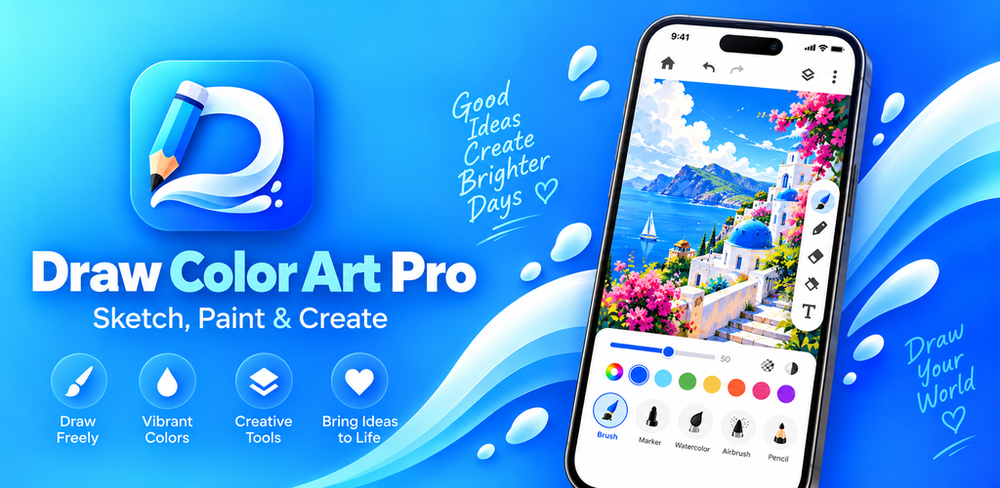
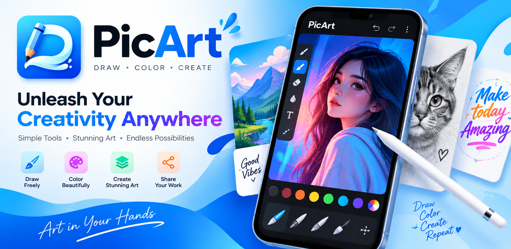
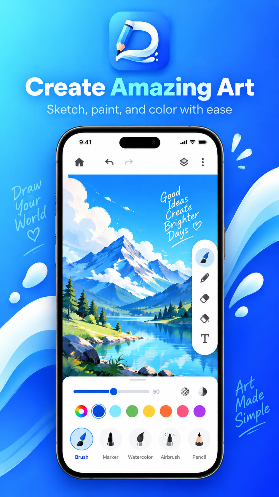
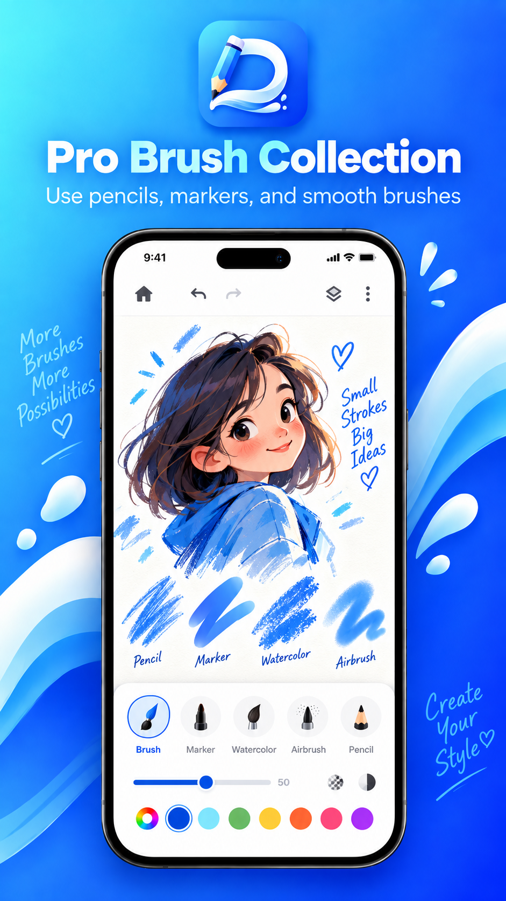
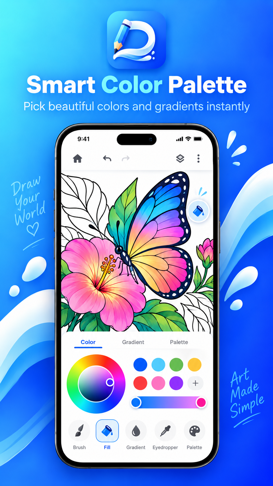
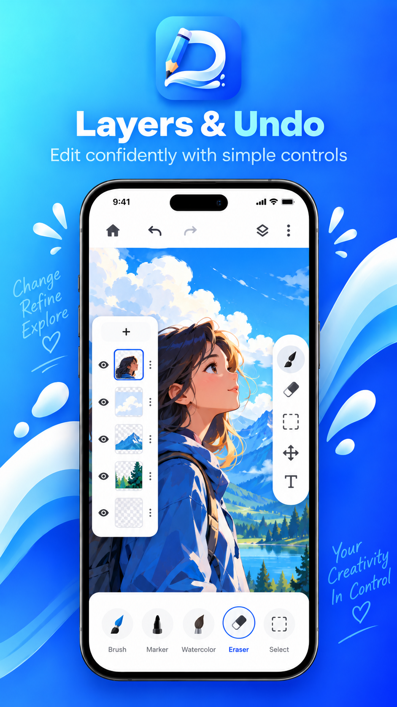
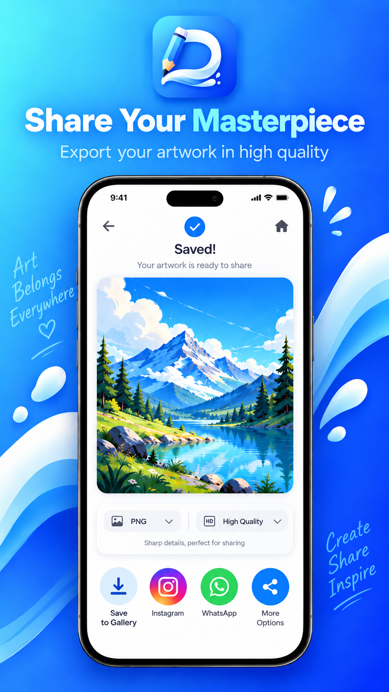

<div align="center">

# 🎨 Draw Color Art Pro
### *Studio-Grade Mobile Digital Art, Sketching & Coloring Suite*

<p align="center">
  
</p>

<!-- 3D Motion Graphic Play Store Button -->
<p align="center">
  <a href="https://play.google.com/store/apps/details?id=com.drawcolor.artpro" target="_blank" rel="noopener noreferrer">
    
  </a>
</p>
<p align="center">
  <a href="https://play.google.com/store/apps/details?id=com.drawcolor.artpro" target="_blank" rel="noopener noreferrer">
    
  </a>
  &nbsp;
  <a href="https://github.com/OPSHARP/draw-color-art-pro/releases/latest" target="_blank" rel="noopener noreferrer">
    
  </a>
</p>

[](https://flutter.dev)
[](https://dart.dev)
[](https://riverpod.dev)
[](https://developer.android.com)
[](privacy.md)
[](LICENSE)

<p align="center">
  <strong>Draw Color Art Pro</strong> is a powerful, fluid, and privacy-first digital painting and coloring application crafted with Flutter. Built with an Apple Human Interface aesthetic, low-latency stylus rendering, and an offline-first architecture, it empowers everyone from beginner coloring enthusiasts to professional digital artists.
</p>

</div>

---

## 🌟 Key Features at a Glance

| Feature | 3D Visual Icon | Description |
| :--- | :---: | :--- |
| **Ultra-Smooth Canvas** | ⚡ | Dynamic hardware optimization supporting **90Hz, 120Hz, 144Hz, and 165Hz** displays for zero-lag brush feedback. |
| **Pro Layer Engine** | 📑 | Unlimited layers with opacity control, blend modes, layer clipping, visibility toggling, and non-destructive reordering. |
| **Advanced Brush Suite** | 🖌️ | Pressure-sensitive pencils, ink pens, markers, airbrushes, oil paint, watercolor simulation, and custom stamp textures. |
| **AR Camera Tracing** | 🔮 | Real-time augmented reality projector projecting outlines onto physical paper using your camera in ephemeral RAM. |
| **200+ Coloring Pages** | 🎨 | Procedurally generated coloring catalog across 16 categories with smart flood fill and line-art edge protection. |
| **Color Harmonies** | 🌈 | Interactive color wheel, complimentary, analogous, and triadic harmonies, plus real-time palette extraction from images. |
| **QuickShape & Symmetry** | 📐 | Instant geometric recognition (lines, circles, polygons) and 1-point, 2-point, and 3-point perspective guides. |
| **ASMR Sound Synthesizer**| 🎧 | Offline interactive audio synthesis mimicking realistic pencil friction, airbrush mist, and paper eraser textures. |
| **100% Artist Ownership** | 💎 | You own 100% of the artwork you create. Commercial and personal freedom with zero developer royalties. |
| **Privacy-by-Design** | 🛡️ | Local-first storage. No cloud tracking, no mandatory logins, and scoped Android system photo picker compliance. |

---

## 📱 App Showcase & Preview

<div align="center">
  <table>
    <tr>
      <td align="center"><b>🎨 Canvas & Tools</b></td>
      <td align="center"><b>🌈 Color Studio</b></td>
      <td align="center"><b>📑 Layer Studio</b></td>
    </tr>
    <tr>
      <td></td>
      <td></td>
      <td></td>
    </tr>
    <tr>
      <td align="center"><b>🔮 AR Tracing Studio</b></td>
      <td align="center"><b>✨ Palette Harmonies</b></td>
      <td align="center"><b>⚙️ Studio Settings</b></td>
    </tr>
    <tr>
      <td></td>
      <td></td>
      <td></td>
    </tr>
  </table>
</div>

---

## 🏗️ Architecture & Core Stack

```
lib/
├── app.dart                   # Application entry, router & theme configuration
├── main.dart                  # Services bootstrap (Display, Ads, Audio, Audio Engine)
├── core/
│   ├── ads/                   # Google AdMob service & local ad-blocker detector
│   ├── audio/                 # ASMR sound effect generator & ambient synthesizers
│   ├── constants/             # App version metadata, design tokens & typography
│   ├── services/              # High-refresh display optimizer & In-App Update API
│   └── theme/                 # Dynamic light/dark theme providers & iOS tokens
├── features/
│   ├── ar_tracing/            # Camera projector overlay for real-world paper tracing
│   ├── brushes/               # Brush presets, dynamics, shaders & textures
│   ├── canvas/                # Multi-layer canvas painter, gestures & tool options
│   ├── colors/                # Color harmonies, RGB/HSV pickers & palette extraction
│   ├── export/                # High-res PNG/JPEG scoped export & social share dialog
│   ├── home/                  # Clean studio landing screen & recent projects
│   ├── layers/                # Layer stack inspector, blend modes & opacity sliders
│   ├── onboarding/            # First-run guided artist walkthrough
│   ├── projects/              # Local SQLite/JSON project storage & cache management
│   ├── settings/              # Studio preferences, display rate & legal screens
│   ├── templates/             # 200 procedural coloring templates (16 categories)
│   └── text/                  # Google Fonts catalog & typography placement tool
└── rendering/
    └── engine/                # Flood fill algorithm, QuickShape & stroke renderer
```

---

## 🚀 Getting Started & Local Setup

### Prerequisites
- [Flutter SDK](https://flutter.dev/docs/get-started/install) (version 3.13.0 or higher)
- [Android Studio](https://developer.android.com/studio) / [VS Code](https://code.visualstudio.com/)
- Android SDK with API Level 34+

### Clone & Install
```bash
# Clone the repository
git clone https://github.com/OPSHARP/draw-color-art-pro.git
cd draw-color-art-pro

# Install dependencies
flutter pub get

# Run on connected device or emulator
flutter run
```

### Build Configuration & Keystore Setup
For public safety, release signing keys and live AdMob keys are excluded from this repository.

1. **Keystore Configuration**:
   Copy the template configuration in `android/`:
   ```bash
   cp android/key.properties.example android/key.properties
   ```
   Fill in your personal release keystore credentials in `android/key.properties`.

2. **Custom AdMob Deployment (Optional)**:
   By default, the application runs safely with official Google Mobile Ads test units. To inject your production AdMob credentials at build time:
   ```bash
   flutter build apk --release \
     --dart-define=ADMOB_APP_ID="ca-app-pub-XXXXXXXXXXXXXXXX~XXXXXXXXXX" \
     --dart-define=ADMOB_BANNER_ID="ca-app-pub-XXXXXXXXXXXXXXXX/XXXXXXXXXX" \
     --dart-define=ADMOB_INTERSTITIAL_ID="ca-app-pub-XXXXXXXXXXXXXXXX/XXXXXXXXXX" \
     --dart-define=ADMOB_APP_OPEN_ID="ca-app-pub-XXXXXXXXXXXXXXXX/XXXXXXXXXX"
   ```

---

## 🛡️ Privacy & Artist Freedom

- **100% Artist Ownership**: You retain exclusive copyright over every artwork you create. You are free to monetize, sell physical prints, produce merchandise, or use your creations in client projects with zero royalties. Read our full [Terms of Service](terms.md).
- **Zero Telemetry**: We do not track you, profile your usage, or upload your artwork to cloud servers. All projects are saved locally on your device. Read our [Privacy Policy](privacy.md).
- **Google Play Compliance**: Uses the modern Android System Photo Picker (`MediaStore.ACTION_PICK_IMAGES`) with zero broad storage permission requests.

---

## 👨‍💻 Author & Support

- **Developer**: SHARP OP
- **Email**: [drillmovies@gmail.com](mailto:drillmovies@gmail.com)
- **GitHub**: [@OPSHARP](https://github.com/OPSHARP)
- **Google Play**: [Draw Color Art Pro on Play Store](https://play.google.com/store/apps/details?id=com.drawcolor.artpro)

---

<div align="center">
  <sub>Built with ❤️ for the global digital art community. If you enjoy Draw Color Art Pro, please give this repository a ⭐!</sub>
</div>
